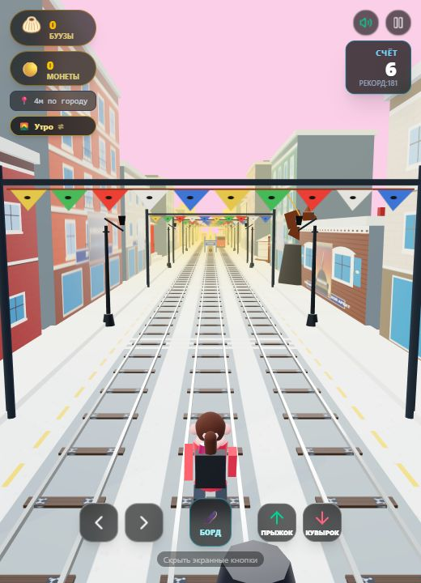
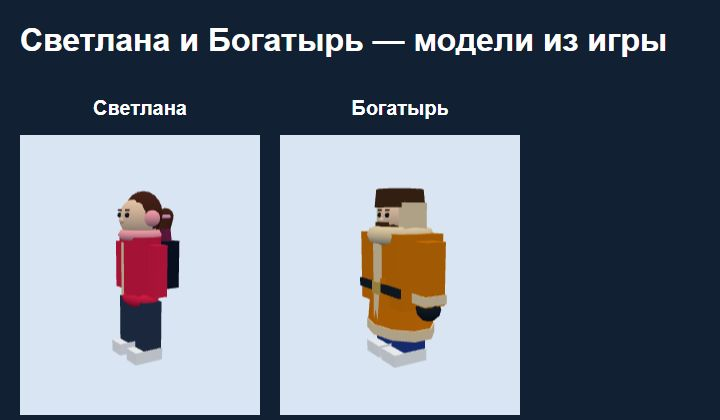
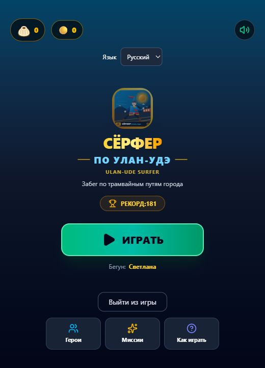

# Сёрфер по Улан-Удэ / Ulan-Ude Surfer

Автор: **Petr Korytov** · Выпуск **26.10.2026** · Версия **1.2.0**

Зимний 3D-раннер по трамвайным путям Улан-Удэ: уклоняйтесь от препятствий, собирайте монеты и буузы, выполняйте миссии и открывайте героев.

[**Играть в браузере**](https://peter20191233.github.io/resume-site/games/ulan-ude-surfer/) · [**Скачать APK для Android**](https://github.com/peter20191233/ulan-ude-surfer/releases/download/v1.2.0/ulan-ude-surfer-1.2.0.apk)

## Демонстрация

## Обновление 1.2.0 — 26.10.2026

- Буузы (позы): новая иконка со складками и отверстием сверху, обновлённая 3D-модель и названия в обоих языках.
- Удалены искусственный рабочий стол и декоративные панели телефона.
- «Выйти из игры» в меню, на паузе и после забега сохраняет прогресс. В Android закрывает Activity и удаляет задачу из недавних приложений.
- В браузере вызывается закрытие вкладки. Если браузер запрещает закрывать вкладку, открытую пользователем, игра останавливается и показывает инструкцию для ручного закрытия.
- Значок Android-приложения создан из `public/icon.svg` — того же изображения, что в главном меню.
- APK подписан прежним ключом: его можно установить поверх 1.1.0 с сохранением прогресса.

## Первый выпуск от 26.10.2026

- Награды, разблокировка и выбор героев с сохранением прогресса.
- Русский и английский языки.

## Как играть

Стрелки / WASD или свайпы: смена полосы, прыжок, кувырок. Пробел / двойной тап: ховерборд. На экране также есть кнопки управления.

**iPhone:** откройте браузерную версию в Safari. Игра использует WebGL 2; нужен современный браузер. Проверка на физическом iPhone не проводилась.

**Android:** скачайте APK, откройте файл и разрешите установку из выбранного источника, если Android попросит. Android 8.0+ и WebView с WebGL 2. Игра полностью включена в APK и работает без сети. Это самостоятельная APK-сборка, не публикация в Google Play.
Прогресс хранится локально и не синхронизируется между браузером и APK.

## Иконка на домашнем экране · 26.10.2026

Автор: Petr Korytov. Браузерная версия использует тот же рисунок, что и APK: PNG 180×180 для iPhone/iPad, PNG 192×192 и 512×512 в веб-манифесте. Значок домашнего экрана статичный.

На iPhone откройте игру в Safari и выберите «Поделиться» → «На экран Домой». На Android откройте меню браузера → «Добавить на главный экран» / «Установить приложение». Добавлять нужно страницу самой игры, а не главную страницу сайта-анкеты. Если ранее был добавлен серый значок с буквой, удалите старый ярлык, заново откройте ссылку на игру с интернетом и добавьте её повторно. Очищать данные браузера не нужно: это удалит сохранённый прогресс.

Это исправление значка не добавляет автономную работу браузерной версии; для её загрузки нужен интернет. APK менять или переустанавливать не требуется.
